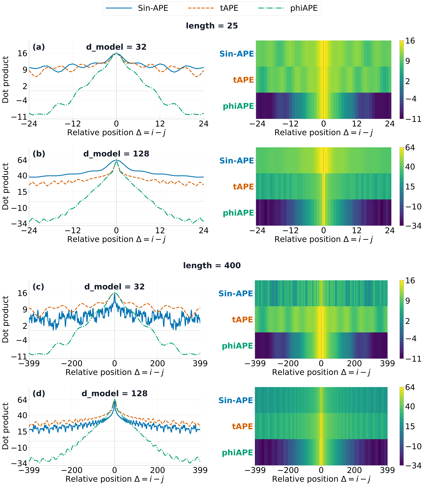

# phiAPE

**Phase-Span Absolute Positional Encoding for time-series Transformers**

Code and seed-level results for *Rethinking Absolute Positional Encoding in
Transformers for Time-Series Modeling* (WSDM 2027). The repository implements
phiAPE for additive positional encoding and phiRoPE for a separate comparison
with RoPE. Both experiments use the same Time Series Transformer (TST)
backbone on the UEA and UCR classification archives. See [Citation](#citation)
for the paper reference.

## One frequency rule, two ways to encode position

A fixed sinusoidal encoding assigns a frequency to each sine/cosine pair.
With a compact embedding and a short sequence, some pairs in the standard
geometric grid can change very little from the first sample to the last.
phiAPE uses the known sequence length to set the phase span covered by each
pair. The slowest pair completes exactly half a cycle over the sequence,
while faster pairs retain different positional scales.

For a sequence of length $L$ and an even encoding width $d$, let $u_j$ denote
the min–max normalized standard geometric frequency grid. With $c=4$ in the
reported experiments, the frequency assigned to pair $j$ is

$$
\omega_{\min}=\frac{\pi}{L-1}, \qquad
\omega_j=\omega_{\min}\left(1+\frac{d}{c}u_j\right).
$$

- **phiAPE** uses the full embedding width $d$. It adds the vector
  $[\sin(p\omega_0),\cos(p\omega_0),\ldots]$ at position $p$ to the
  projected input. The encoding adds no trainable parameters.
- **phiRoPE** evaluates the same rule at the per-head width $d_h=d/8$.
  As in standard RoPE, each attention head rotates the projected queries
  and keys by position and passes values through unrotated. The two rotary
  conditions differ only in their frequencies. At model widths 32 and 128,
  each head has two and eight rotary pairs, respectively.

<!--
Place the overview illustration here when assets/phiAPE_method_overview.png
is available. Use the alt text and caption in assets/README.md.
-->

<details>
<summary>Positional similarity across short and long sequences</summary>



*Unnormalized positional similarity* $K(\Delta)=\sum_j\cos(\Delta\omega_j)$
*over* $\Delta=-(L-1),\ldots,L-1$. The curves and heatmaps show the same
computed values. Each configuration uses a common color scale across methods.

</details>

## Installation and experiment environments

### Reproduce the paper tables on your machine

The validated reporting setup uses Python 3.12.7, NumPy 1.26.4,
pandas 2.2.3, and SciPy 1.13.1. From the repository root, create an
environment with Python 3.12 and install the versions in
[requirements.txt](requirements.txt).

```bash
python3.12 -m venv .venv
source .venv/bin/activate
python -m pip install -r requirements.txt
python -m pip install -e .
```

On Windows, use `py -3.12 -m venv .venv` and activate with
`.venv\Scripts\Activate.ps1` in PowerShell. The reporting commands run on CPU.
For training, you can install a PyTorch 2.6.0 build for your CPU or CUDA
platform before installing the requirements. Install `gdown` if the UEA
loader needs to download a dataset from Google Drive.

### Original training environment

The archived additive runs came from the v7 UEA and v9 UCR TST experiments.
The rotary runs came from v28. The original Raven jobs used Python 3.9 with
the following modules:

```bash
module load cuda/11.4
module load anaconda/3/2021.11
module load pytorch/gpu-cuda-11.4/1.13.0
module load cudnn/8.2.4
```

The experiment setup created a virtual environment with
`python -m venv --system-site-packages` to inherit the module's PyTorch.
[requirements-hpc.txt](requirements-hpc.txt) records the union of the
original UEA and UCR dependency lists. Most versions were left unpinned in
those lists, so the module stack and requirements document the original
setup without claiming an exact environment lock. Use the Python 3.12 setup
above to reproduce the published analysis from the archived runs.

## Reproduce Table 2 from the archived runs

```bash
phiape-benchmarks table2
```

The command calculates all four rows directly from the
[10,112 bundled rotary seed results](rotary_reference_results/README.md).
It writes `phiRoPE_transfer_summary.tex` and the full-precision
`phiRoPE_transfer_summary.csv` under `outputs/reports/`. This workflow runs
on a CPU and requires only the repository's bundled results as input.

| Setting | RoPE (%) | phiRoPE (%) | Gain (pp) | Wins / ties / losses | Holm-adjusted p |
|---|---:|---:|---:|:---:|---:|
| UEA, d = 32 | 64.82 | 66.96 | +2.14 | 24 / 1 / 5 | 0.0014 |
| UEA, d = 128 | 67.43 | 68.11 | +0.69 | 19 / 0 / 11 | 0.0654 |
| UCR, d = 32 | 59.81 | 62.96 | +3.15 | 94 / 3 / 31 | <0.001 |
| UCR, d = 128 | 67.14 | 67.81 | +0.67 | 71 / 4 / 53 | 0.0860 |

Each dataset contributes one accuracy per method, calculated from integer
correct-prediction counts across its 16 paired repeats. The archive means
weight datasets equally. Gains and win/tie/loss counts are in the direction
phiRoPE minus RoPE. The two-sided paired Wilcoxon tests use differences
rounded to 12 decimals. The exact test is used for at most 50 differences
when none is zero and their absolute ranks are untied. Other nondegenerate
settings use the tie-adjusted normal approximation without continuity
correction. Holm correction covers the four archive–dimension tests.
The gains at $d=32$ are significant at an adjusted threshold of 0.05.

If you have the original v28 experiment directory, you can generate the same
table directly from its run CSVs using
`phiape-benchmarks table2 --v28-root "/path/to/HPC-APE v28 TST RoPE"`.

## Reproduce Table 1 and Figure 4 from the archived runs

```bash
phiape-benchmarks check
phiape-benchmarks report
```

These commands use the [25,280 bundled additive seed results](reference_results/README.md)
for No-APE, Learned APE, Sin-APE, tAPE, and phiAPE. The report writes Table 1
as LaTeX, the four rank panels for Figure 4, numeric CSVs, and an Excel
workbook under `outputs/reports/`.

The analysis averages the 16 repeats within each dataset and compares methods
using the paired dataset means. Each archive and embedding width has its own
Friedman test and ten two-sided paired Wilcoxon tests, adjusted together by
Holm step-down. The paired tests follow the same rule for exact and approximate
p-values as Table 2. The report's tables and rank diagrams use the same
adjusted decisions. Each diagram bar identifies a maximal group whose member
pairs are all nonsignificant at 0.05. The JSON beside each panel records the
group members and their average ranks.

The reporting commands cover the main paper's additive and rotary TST results.
Per-dataset means are available in the CSV and workbook for inspection.

## Train on your own machine

Start with a small paired run before training over the full archives.

```bash
phiape-benchmarks run --rotary --archive ucr --dimension 32 --datasets ECG200 --seeds 2026
```

This trains both rotary methods for one seed and writes their runs to
`outputs/rotary/`. Table 2 requires complete results for both methods on
all four settings. To train and report the full comparison, use

```bash
phiape-benchmarks run-all --rotary
phiape-benchmarks table2 --input outputs/rotary --report-dir outputs/retrained-rotary
```

For the five additive conditions, use

```bash
phiape-benchmarks run-all
phiape-benchmarks report --input outputs --report-dir outputs/retrained-additive
```

A full run trains 10,112 rotary models or 25,280 additive models. Runs use
CUDA when available and fall back to CPU. The data loaders cache the datasets
under `datasets/` and results are saved after each completed repeat. Restart
the same command to resume. Use `--data-root` and `--output-root` to choose
different directories. Fresh training results can vary with hardware,
library versions, and archive versions even with the same seeds. Each new
run records its software and device environment.

### Shared training protocol

| Setting | Value |
|---|---|
| Archives | 30 multivariate UEA datasets and 128 univariate UCR datasets |
| Embedding widths | 32 and 128 |
| Model seeds | 2026–2041, paired across methods |
| Validation | 20% of training data, split seed 2026 |
| Input processing | Sequences capped at 512 steps, with channel standardization fitted on the training split |
| TST backbone | 3 layers, 8 attention heads, feed-forward width 256, dropout 0.20 |
| Optimization | AdamW, learning rate 0.001, weight decay 0.0001, gradient clipping norm 4 |
| Training budget | Batch size 64, up to 200 epochs, early stopping patience 32 |
| Model selection | Minimum validation loss, then evaluation on the archive test split |

The same split, model seeds, and training settings are used for the two
rotary conditions. Each reference manifest records the training protocol,
source hashes, and expected coverage. The reporting commands validate the
seed-level inputs before calculating results.

## Repository guide

| Location | Contents |
|---|---|
| [src/phiape_benchmarks/](src/phiape_benchmarks/) | TST model, positional encodings, loaders, runner, and reports |
| [reference_results/](reference_results/) | Five-method additive seed results and provenance |
| [rotary_reference_results/](rotary_reference_results/) | RoPE and phiRoPE seed results and provenance |
| [assets/](assets/README.md) | Positional-similarity figure and overview illustration brief |
| [tests/](tests/) | Model, runner, and report checks |
| [LICENSE](LICENSE) | MIT license for the software |

To run the checks locally, install the test extra with
`python -m pip install -e ".[test]"` and run `pytest`.

## License

The repository software is licensed under the [MIT License](LICENSE).
The ACM paper is licensed under [CC BY 4.0](https://creativecommons.org/licenses/by/4.0/).

## Citation

Sajjad Shumaly and Mahsa Salehi. 2027. *Rethinking Absolute Positional
Encoding in Transformers for Time-Series Modeling*. In Proceedings of the
20th ACM International Conference on Web Search and Data Mining (WSDM ’27),
Hong Kong, February 15–19, 2027.

```bibtex
@inproceedings{shumaly2027phiape,
  author    = {Shumaly, Sajjad and Salehi, Mahsa},
  title     = {Rethinking Absolute Positional Encoding in Transformers for Time-Series Modeling},
  booktitle = {Proceedings of the 20th ACM International Conference on Web Search and Data Mining},
  series    = {WSDM '27},
  year      = {2027},
  month     = feb,
  address   = {Hong Kong}
}
```
